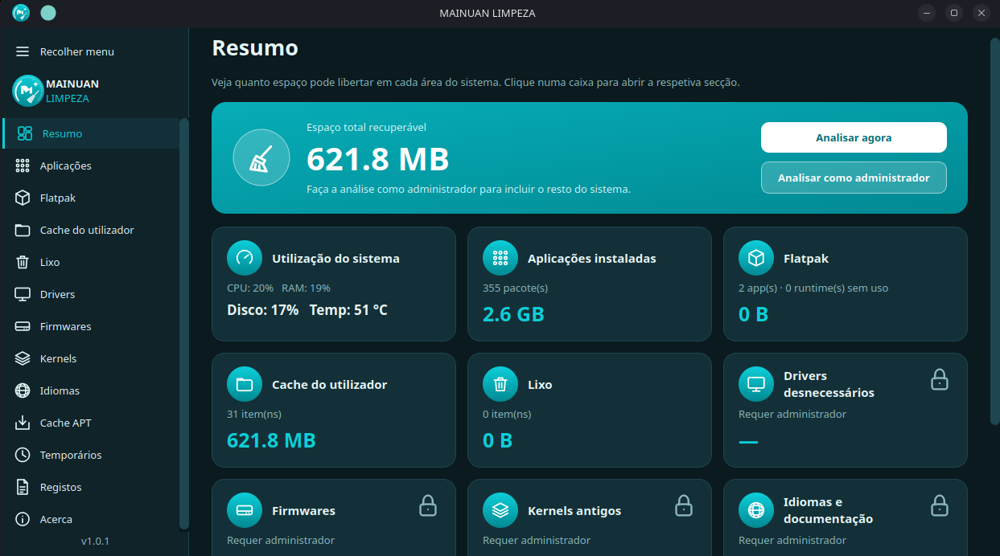

<p align="center"></p>

# MAINUAN LIMPEZA


Limpeza completa do sistema para **Ubuntu 26.04 e mais recentes** (e derivados de Debian), com o visual da família MAINUAN.
Analisa quanto espaço pode libertar e limpa, com confirmação, cada área do sistema.



## Funcionalidades

| Menu | O que faz |
|---|---|
| **Resumo** | Espaço total recuperável e caixas com o estado de cada área; clique para abrir a secção |
| **Aplicações** | Lista e desinstala pacotes instalados manualmente |
| **Flatpak** | Desinstala aplicações e runtimes Flatpak sem uso |
| **Cache do utilizador** | Limpa `~/.cache` |
| **Lixo** | Esvazia o lixo |
| **Drivers** | Remove drivers de hardware que não existe no computador |
| **Firmwares** | Remove famílias de firmware não necessárias (as exigidas pelo hardware ficam bloqueadas) |
| **Kernels** | Remove kernels antigos; o kernel em uso e o mais recente ficam protegidos |
| **Idiomas** | Remove traduções e documentação não usadas (o seu idioma e o inglês ficam protegidos) |
| **Cache APT** | Limpa ficheiros `.deb` em cache e pacotes órfãos |
| **Temporários** | Limpa `/tmp` e `/var/tmp` com filtro por idade |
| **Registos** | Limpa `/var/log` e o diário do sistema (journald) |

Os menus que precisam de privilégios pedem a palavra-passe de administrador **uma única vez** por sessão (polkit).

## Instalação

Descarregue o `.deb` em [Releases](../../releases/latest) e instale:

```bash
sudo apt install ./mainuan-limpeza_1.0.1_all.deb
```

Depois abra **MAINUAN LIMPEZA** no menu de aplicações ou execute `mainuan-limpeza`.

Dependências (instaladas automaticamente): Python 3, PySide6 (ou PyQt5), polkit (`pkexec`), `apt`.

## Idiomas

Português (PT), português (BR), espanhol, francês e inglês. O idioma é detetado automaticamente a partir do sistema; qualquer outro usa inglês.

## Compilar o pacote

```bash
git clone https://github.com/tugatechlabDC/mainuan-limpeza.git
cd mainuan-limpeza
./build.sh          # cria dist/mainuan-limpeza_<versão>_all.deb
```

Estrutura:

```
packaging/mainuan-limpeza/   # conteúdo do pacote DEB
  DEBIAN/                    # control, postinst, postrm
  usr/bin/                   # lançador
  usr/lib/mainuan-limpeza/   # aplicação (Qt), helper e módulos de análise
  usr/share/                 # atalho, ícones, política polkit, copyright
docs/                        # imagens do README
```

## Segurança

Todas as operações com privilégios passam por um helper (`helper.py`) que só aceita caminhos dentro de zonas permitidas (`/tmp`, `/var/log`, cache APT, idiomas, documentação, kernels) e nomes de pacotes validados. Nada é executado através de shell.

## Contribuir

Sugestões, relatos de erros e pedidos de melhoria são bem-vindos na secção [Issues](../../issues). Ao reportar um erro, indique a sua distribuição, a versão do pacote e o ambiente de trabalho.

## Autor

**David Caixinha** — tugatechlaDC

## 🤝 Contribuição

Para reportar erros ou pedir funcionalidades, abre um [Issue](https://github.com/mainuan/mainuan-limpeza/issues). Para propor alterações, envia um pull request para o ramo `main` e regista qualquer alteração visível no [CHANGELOG.md](CHANGELOG.md).


## Licença

Este programa é software livre: pode redistribuí-lo e/ou modificá-lo nos termos da Licença Pública Geral GNU, versão 3 ou posterior. Consulte o ficheiro [LICENSE](LICENSE).

